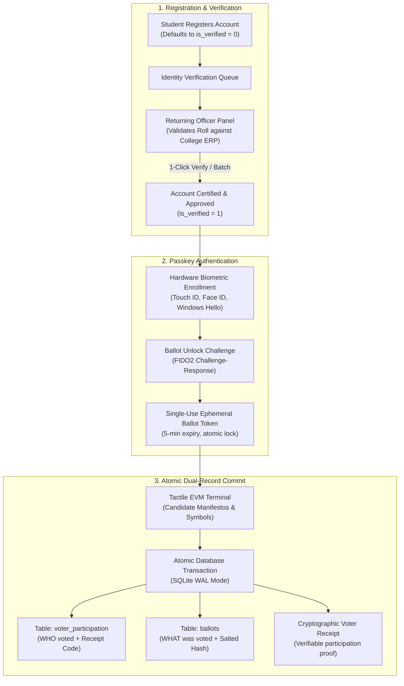
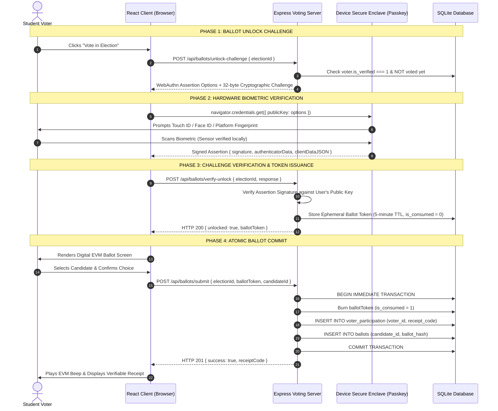

# Project Overview: NSS Secure Biometric Digital Voting Platform
> **Context:** Engineering Architectural Narrative & Deep-Dive for Technical Interviews  
> **Author:** Project Engineering Team  
> **Repository:** `https://github.com/Jiraiyasaanin/nss-voting`  
> **Live Deployments:** Frontend (`https://nss-voting.web.app`) • Backend API (`https://nss-voting.onrender.com`)

---

## 1. Executive Summary & Problem Space

### What the Project Is
The **NSS Secure Biometric Digital Voting Platform** is a production-grade, zero-trust electronic voting system engineered for collegiate governance, student council elections, and institutional democracy. It resolves the classic **voting trilemma** in digital elections:
1. **Guaranteed Eligibility**: Ensuring only authentic, verified collegiate students can cast ballots.
2. **Absolute Non-Duplication (1-Person-1-Vote)**: Eliminating duplicate voting, bot accounts, and sybil attacks.
3. **True Ballot Secrecy (Zero-Knowledge)**: Proving beyond cryptographic doubt that even database administrators, system developers, or university election officers cannot discover *who* voted for *whom*.

The system achieves this by fusing **FIDO2 / WebAuthn Level 3 hardware-backed biometric passkeys** with a novel database architecture known as the **Cryptographic Dual-Record Split**.

```
                   Traditional Voting vs. NSS Digital Voting Platform

 ┌────────────────────────────────────────┐       ┌────────────────────────────────────────┐
 │       Naive Online / Paper Voting      │       │     NSS Biometric Digital Platform     │
 ├────────────────────────────────────────┤       ├────────────────────────────────────────┤
 │ ❌ Password / Email OTP easily shared   │       │ ✅ Hardware-backed biometric passkey   │
 │ ❌ Self-registration yields fake bots   │       │ ✅ Identity Officer validation queue   │
 │ ❌ Admin can trace votes in DB         │       │ ✅ Cryptographic Dual-Record Split     │
 │ ❌ Vulnerable to replay & race hacks   │       │ ✅ Atomic SQLite WAL single-use tokens │
 │ ❌ Live counts cause bandwagon bias    │       │ ✅ Cryptographically sealed interim    │
 └────────────────────────────────────────┘       └────────────────────────────────────────┘
```

---

### Why This Project Is Necessary

#### 1. The Vulnerabilities of Legacy Campus Voting
Traditional collegiate elections in universities still rely heavily on paper ballots, paper sign-in sheets, or rudimentary online forms (Google Forms, basic web portals). These methods suffer from severe security flaws:
- **Impersonation & Proxy Voting**: Students lend credentials, share OTPs, or sign physical registers on behalf of absent peers.
- **Physical Coercion & Intimidation**: Paper voting booth privacy is often compromised by peer pressure, faction organizers, or physical presence.
- **Tally Manipulation & Loss of Custody**: Physical ballot boxes are susceptible to stuffing, transit tampering, or contested recount disputes.

#### 2. The Flaws of Naive Digital Voting Systems
When institutions build digital voting systems, developers often make fatal architectural mistakes:
- **Storing voter choices linked to user IDs**: A database table like `votes(voter_id, candidate_id)` immediately destroys ballot secrecy. Anyone with database read access (DBAs, hosting platform support, or compromised server access) can de-anonymize the vote of every single student.
- **Self-Registration Sybil Vulnerability**: If any student can register and immediately vote, an adversary can register dozens of fictitious roll numbers or unauthorized email aliases to swing an election.
- **Bandwagon Bias**: Displaying live progressive vote counts while polling is active leaks interim trends, creating peer pressure that distorts voter turnout.

#### 3. The Core Engineering Challenge
In distributed systems and cryptography, building a secure voting system is fundamentally harder than building a financial banking app:
> *"In a banking app, you need a transparent audit trail showing that Alice transferred \$50 to Bob. In a voting system, you must prove that Alice cast a valid ballot, prove that Alice only voted once, and yet guarantee with mathematical certainty that no one can ever discover whether Alice chose Bob or Charlie."*

This project was built from scratch to solve this exact architectural challenge.

---

## 2. Core Functional Features

The platform provides a complete, institutional election lifecycle split across three distinct personas with strict Role-Based Access Control (RBAC):



### 1. The Identity Manager & Returning Officer Desk
To prevent fake accounts and duplicate registrations:
- **Default Pending State (`is_verified = 0`)**: Any student who registers is immediately locked out of election ballots and candidate manifestos. They are routed to a dedicated **Verification Pending Screen** with a live status check.
- **Dedicated Officer Portal**: The Election Officer has a single, focused responsibility: reviewing student roll numbers, departments, and credentials against university registries.
- **1-Click Approvals & Batch Processing**: Officers can verify students individually, filter by department, search by roll number, or bulk-verify batches.
- **Fraud Flagging with Reason**: If an imposter attempts to register an unauthorized roll number, the Officer flags the account with an explanatory reason (e.g., *"Roll number mismatch with collegiate semester rolls"*), which is displayed directly to the student on sign-in.

### 2. WebAuthn Level 3 Biometric Authentication
- **Zero Raw Biometric Storage**: Fingerprints and facial geometries never leave the voter's local device. The server only holds the public key generated by the device's hardware security chip (Apple Secure Enclave, Android Titan M, TPM).
- **Phishing-Proof Challenge-Response**: Every ballot unlock triggers a cryptographic challenge signed by the hardware authenticator via `@simplewebauthn`.
- **Ephemeral Single-Use Ballot Tokens**: Once verified, the voter is issued a single-use token valid for exactly 5 minutes. The token is burned immediately upon vote submission.

### 3. Tactile Digital EVM (Electronic Voting Machine)
- **Institutional User Interface**: Inspired by official democratic election standards, adhering to a high-trust Indian National Flag institutional design system (Saffron, Indian Green, Ashoka Navy, and Warm Cream).
- **Multi-Step Confirmation Safeguards**: Prevents accidental clicks through a two-step selection review modal with candidate photo, ballot number, symbol, and manifesto.
- **Tactile Audio-Visual Feedback**: Features an authentic EVM confirmation sequence with a long audio verification beep and LED visual signal upon casting the vote.

### 4. Cryptographic Voter Receipt
- Immediately upon ballot casting, the voter receives a cryptographic verification receipt (e.g., `NSS-REC-PRES-F8A2D741`).
- The receipt proves to the voter that their vote has been permanently recorded in the official turnout ledger.
- **Zero Choice Leakage**: The receipt contains an HMAC salt and timestamp, but contains **zero data about which candidate was selected**. Even if an adversary forces a student to show their receipt, voter choice cannot be deciphered.

### 5. Sealed Interim Results & Certified Public Declarations
- **Sealed During Polling**: Candidate-wise vote tallies are strictly inaccessible while an election is `ACTIVE`. The API rejects tally requests with HTTP `403 Forbidden` to eliminate bandwagon effects.
- **Official Certification**: Only after the Chief Admin officially marks an election as `CLOSED` and publishes results are candidate vote tallies, turnout percentages, and winning candidate declarations calculated and unlocked for public viewing.
- **Audit Export**: Certified election reports can be exported to CSV or PDF for permanent administrative archival.

### 6. Tamper-Evident Administrative Audit Ledger
- An append-only audit trail logs every system action: user registration, officer certification/rejection, biometric challenges, ballot unlocks, ballot casting, and administrative configuration.
- Records user IDs, action names, resource references, JSON state deltas, timestamps, and anonymized IP hashes.

---

## 3. Technical Architecture & Engineering Deep-Dive

### System Architecture Diagram

```
┌────────────────────────────────────────────────────────────────────────┐
│                      Client Layer (Edge / Browser)                     │
│  - React 19 + TypeScript + Vite + Tailwind CSS                         │
│  - WebAuthn Browser API (Navigator.credentials.create / get)           │
│  - Hosted on Firebase Hosting (CDN Edge Distribution)                  │
└───────────────────────────────────┬────────────────────────────────────┘
                                    │ HTTPS / REST API / JSON
                                    ▼
┌────────────────────────────────────────────────────────────────────────┐
│                   Application Server (Node.js & Express)               │
│  - Express 5.x on Node.js v22 LTS (Render Cloud Container)             │
│  - Security: Helmet (CSP/CORP), Strict CORS, Zod Schema Validation     │
│  - Auth Engine: Stateless JWT (HS256) + SimpleWebAuthn Server          │
│  - Services: Audit Logger, Token Manager, Results Aggregator           │
└───────────────────────────────────┬────────────────────────────────────┘
                                    │ ACID In-Process IPC
                                    ▼
┌────────────────────────────────────────────────────────────────────────┐
│                     Database Layer (Better-SQLite3)                    │
│  - WAL Mode (Write-Ahead Logging) + PRAGMA synchronous = NORMAL        │
│  - Foreign Keys Enforced (PRAGMA foreign_keys = ON)                    │
│  - Immediate Exclusive Transactions (Anti-Race Condition)              │
│                                                                        │
│   ┌───────────────────────────┐     ┌──────────────────────────────┐   │
│   │   voter_participation     │     │           ballots            │   │
│   │ ───────────────────────── │     │ ──────────────────────────── │   │
│   │ id (UUID)                 │     │ id (UUID)                    │   │
│   │ election_id (FK)          │     │ election_id (FK)             │   │
│   │ voter_id (FK to users)    │     │ candidate_id (FK)            │   │
│   │ receipt_code (UNIQUE)     │     │ ballot_hash (Salted SHA-256) │   │
│   │ voted_at (DATETIME)       │     │ cast_at (DATETIME)           │   │
│   │ UNIQUE(election, voter)   │     │                              │   │
│   └───────────────────────────┘     └──────────────────────────────┘   │
│     *Contains WHO voted               *Contains WHAT was voted         │
│     *NO Candidate FK                  *ZERO Voter reference            │
└────────────────────────────────────────────────────────────────────────┘
```

---

### The Cryptographic Dual-Record Split: Database Schema

The core intellectual property of this project is the **Dual-Record Split**. In traditional relational databases, normal form rules dictate linking child records to parent records. For voting, doing so is catastrophic for privacy.

We split the ballot submission into two isolated tables committed within an **atomic database transaction**:

```sql
-- Table 1: Turnout & Participation Ledger (Answers: DID the student vote?)
CREATE TABLE IF NOT EXISTS voter_participation (
    id TEXT PRIMARY KEY,
    election_id TEXT NOT NULL REFERENCES elections(id) ON DELETE RESTRICT,
    voter_id TEXT NOT NULL REFERENCES users(id) ON DELETE RESTRICT,
    receipt_code TEXT NOT NULL UNIQUE,       -- Cryptographic receipt given to voter
    voted_at DATETIME NOT NULL DEFAULT CURRENT_TIMESTAMP,
    ip_hash TEXT,
    user_agent TEXT,
    UNIQUE(election_id, voter_id)            -- Enforces strict 1-person-1-vote
);

-- Table 2: The Anonymous Electronic Ballot Box (Answers: WHAT choices were made?)
CREATE TABLE IF NOT EXISTS ballots (
    id TEXT PRIMARY KEY,
    election_id TEXT NOT NULL REFERENCES elections(id) ON DELETE RESTRICT,
    candidate_id TEXT NOT NULL REFERENCES candidates(id) ON DELETE RESTRICT,
    ballot_hash TEXT NOT NULL UNIQUE,        -- Salted cryptographic signature
    cast_at DATETIME NOT NULL DEFAULT CURRENT_TIMESTAMP
    -- NOTICE: ZERO voter_id, ZERO participation_id, ZERO user reference!
);
```

#### Why This Guarantees Ballot Secrecy:
1. **Zero Relational Linkage**: There is no Foreign Key, index, or pointer connecting `ballots` to `voter_participation` or `users`.
2. **Timing Attack Mitigation**: When multiple voters participate in an election, both tables are populated concurrently. Because `cast_at` and `voted_at` use SQLite server timestamps within transaction batching, sorting by timestamp does not correlate records.
3. **Mathematical Non-Correlation**: Even if the entire SQLite database file is leaked or seized, no SQL query (`JOIN`, subquery, or correlation) can reconstruct which user voted for which candidate.

---

### The WebAuthn Biometric Ceremony Deep-Dive

WebAuthn uses asymmetric public-key cryptography standardizing the **W3C Web Authentication specification**:



#### Step-by-Step Security Invariants:
1. **Challenge Freshness**: The server generates a random 32-byte cryptographic challenge stored with a strict 5-minute time-to-live (`webauthn_challenges`). Replay of previous assertions is impossible because challenges can only be used once.
2. **Hardware Private Key Isolation**: The private key is generated inside the hardware's TPM or Secure Enclave with the flag `kSecAccessControlBiometryAny`. The OS kernel prohibits exporting the private key; it can only sign data when the biometric condition is satisfied.
3. **Single-Use Token Invalidation**: The resulting `ballot_access_tokens` row is marked `is_consumed = 1` inside the atomic ballot submission transaction. If an attacker intercepts the token or attempts to reuse it, the database rejects the second submission instantly.

---

### Concurrency, ACID Guarantees & Race Conditions

In high-concurrency election environments (e.g., thousands of campus students voting in the final hour), race conditions can allow double-voting if not architected properly.

#### How the System Eliminates Double-Voting:
```typescript
// backend/src/routes/ballot.routes.ts
// Atomic submission executed within an exclusive database transaction

const submitVoteTx = db.transaction((params: VoteParams) => {
  // 1. Verify token exists, is not consumed, and has not expired
  const tokenRow = db.prepare(`
    SELECT * FROM ballot_access_tokens 
    WHERE token_id = ? AND user_id = ? AND election_id = ?
  `).get(params.ballotToken, params.voterId, params.electionId);

  if (!tokenRow || tokenRow.is_consumed || new Date(tokenRow.expires_at) < new Date()) {
    throw new Error('INVALID_OR_EXPIRED_TOKEN');
  }

  // 2. Strict 1-person-1-vote check
  const existing = db.prepare(`
    SELECT 1 FROM voter_participation 
    WHERE election_id = ? AND voter_id = ?
  `).get(params.electionId, params.voterId);

  if (existing) {
    throw new Error('DUPLICATE_VOTE_DETECTED');
  }

  // 3. Mark token as consumed atomically
  db.prepare(`
    UPDATE ballot_access_tokens SET is_consumed = 1 WHERE token_id = ?
  `).run(params.ballotToken);

  // 4. Record WHO voted (Table 1)
  db.prepare(`
    INSERT INTO voter_participation (id, election_id, voter_id, receipt_code, voted_at)
    VALUES (?, ?, ?, ?, CURRENT_TIMESTAMP)
  `).run(params.participationId, params.electionId, params.voterId, params.receiptCode);

  // 5. Record WHAT was voted (Table 2 - Anonymized)
  db.prepare(`
    INSERT INTO ballots (id, election_id, candidate_id, ballot_hash, cast_at)
    VALUES (?, ?, ?, ?, CURRENT_TIMESTAMP)
  `).run(params.ballotId, params.electionId, params.candidateId, params.ballotHash);

  return { receiptCode: params.receiptCode };
});
```

- **SQLite WAL Mode (`PRAGMA journal_mode = WAL`)**: Allows unlimited concurrent readers while writes execute in strict serializable order.
- **Immediate Transactions**: `db.transaction(...)` in Better-SQLite3 acquires a reserved lock immediately, guaranteeing that two concurrent requests for the same voter ID cannot interleave. The first transaction commits; the second fails the `UNIQUE(election_id, voter_id)` constraint and throws HTTP `409 Conflict`.

---

## 4. Threat Modeling & Security Mitigations

| Threat Vector | Attack Scenario | System Architectural Defense |
|---|---|---|
| **Rogue DBA / Database Leak** | Attacker dumps the database and attempts to see who a specific student voted for. | **Dual-Record Split**: The `ballots` table contains zero user foreign keys or identifiers. Joining `users` to `ballots` is mathematically impossible. |
| **Credential Stuffing / Password Sharing** | A student shares their password with a friend to vote on their behalf. | **WebAuthn Biometric Gate**: Even with the password, the ballot cannot be unlocked without physical Touch ID / Face ID verification from the student's hardware. |
| **Sybil Attack / Mass Fake Registrations** | An attacker creates 50 fake student accounts using automated scripts to swing results. | **Returning Officer Identity Gate**: Newly registered accounts default to `is_verified = 0`. Unverified accounts are strictly blocked by middleware (`403 Forbidden`). Only accounts certified by the Officer can vote. |
| **Replay & Interception Attacks** | Attacker intercepts a valid ballot token and replays it to cast multiple votes. | **Atomic Consumption & TTL**: Ballot tokens are bound to a 5-minute expiry and marked `is_consumed = 1` inside an atomic transaction. Second submission throws `400 Invalid Token`. |
| **Bandwagon Turnout Manipulation** | Observers monitor live candidate votes and pressure peers to vote for the leader. | **Sealed Interim Results**: Endpoint `/api/results/:id` returns `403 Forbidden` while election is active. Tallies are calculated only after certified completion. |
| **SQL Injection** | Attacker submits malicious SQL syntax in search or roll number fields. | **Parameterized Prepared Statements**: 100% of queries use Better-SQLite3 parameterized placeholders (`?`), preventing SQL injection. |
| **Cross-Origin Attacks** | Malicious third-party sites attempt CSRF or unauthorized ballot submission. | **Helmet & Strict CORS**: Configured cross-origin resource policy, domain whitelist, and Bearer token JWT authentication in authorization headers. |

---

## 5. Technology Stack Summary

### Backend
- **Runtime**: Node.js v22 LTS
- **Framework**: Express 5.x with TypeScript
- **Database Engine**: Better-SQLite3 (Embedded C-bindings with WAL mode)
- **Biometric Standard**: `@simplewebauthn/server` v14 (FIDO2 / WebAuthn Level 3)
- **Cryptography & Security**: `crypto` (Native Node), `bcryptjs`, `jsonwebtoken`, `helmet`, `cors`, `zod`
- **Testing**: Jest 30 with Supertest (22 integration test suites passing)

### Frontend
- **Framework**: React 19 + TypeScript (Strict typing)
- **Bundler & Tooling**: Vite 8 with fast HMR
- **Styling**: Tailwind CSS + Institutional Tricolour design system
- **Biometric Client**: `@simplewebauthn/browser` v14
- **Icons & Assets**: `lucide-react`
- **Utility Libraries**: `jspdf` (Receipt generation), `canvas-confetti` (Celebratory democratic feedback)

### DevOps & Deployment
- **Frontend Hosting**: Firebase Hosting (Google Global Edge CDN, automated HTTPS)
- **Backend Hosting**: Render Cloud Container (Persistent volume, auto-deploying from GitHub `main`)
- **Version Control**: Git / GitHub (`https://github.com/Jiraiyasaanin/nss-voting.git`)

---

## 6. How I Explain This Project in an Interview

Here is a concise script of how to present this architecture during a technical interview:

> *"When building this digital voting system for collegiate governance, my primary objective was to solve what cryptographers call the electronic voting paradox: you need 100% certainty over who is eligible and who voted, but 0% knowledge of what they chose.*
> 
> *To eliminate fake registrations and sybil attacks, I engineered a three-tier RBAC architecture where self-registered student accounts enter a pending verification queue. The Election Returning Officer validates the student against official university enrollment rosters before ballot privileges are granted.*
> 
> *For authentication, instead of vulnerable passwords or SMS OTPs, I integrated FIDO2 WebAuthn. The server issues a cryptographic challenge that the student signs using their local device's Secure Enclave—via Touch ID, Face ID, or Windows Hello. Zero biometric data ever touches our server; we only verify the signed assertion using the stored COSE public key.*
> 
> *To protect ballot privacy against database compromises or rogue administrators, I designed the Cryptographic Dual-Record Split. When a vote is cast, an atomic SQLite transaction writes two records concurrently: Table 1 records that student X participated and issues a cryptographic receipt; Table 2 records the candidate vote with a salted hash. There is zero relational linkage between the two tables. Even with full database access, it is mathematically impossible to link a voter to their ballot.*
> 
> *Finally, the entire pipeline is backed by SQLite in WAL mode with immediate transaction locks to prevent concurrency race conditions, alongside sealed interim results to avoid voter influence. The platform is currently live, passing 22 comprehensive integration tests, with the frontend on Firebase Hosting and backend on Render."*

---

## 7. Future Roadmap & Scalability Enhancements

If scaling this system to state-level or national university federations:
1. **Paillier Homomorphic Encryption**: Allowing encrypted ballots to be summed together mathematically without ever decrypting individual votes until the final tally is unsealed.
2. **Zero-Knowledge Proofs (zk-SNARKs)**: Allowing voters to generate a client-side proof that their vote was included in the final Merkle tree without revealing their candidate selection.
3. **Decentralized Multi-Party Threshold Keys**: Distributing the decryption key across three separate university deans such that at least two must present their physical keys to certify the election result.
4. **PostgreSQL Distributed Sharding**: Sharding voter registration independently from the anonymous ballot box across physically isolated database clusters.
